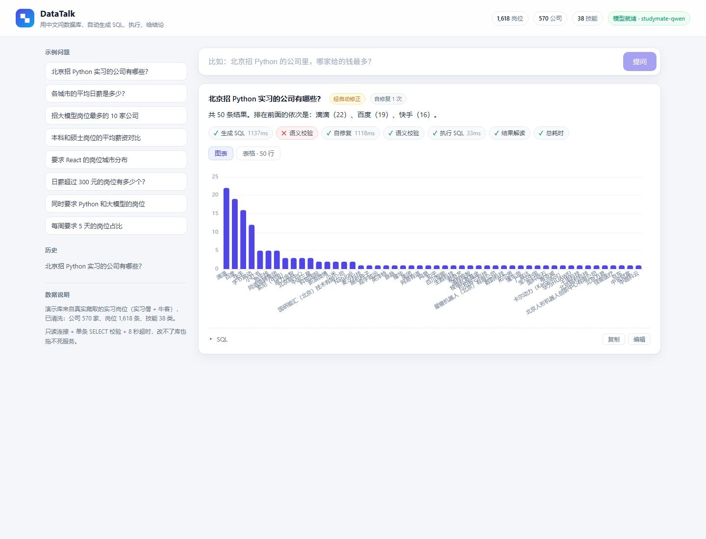
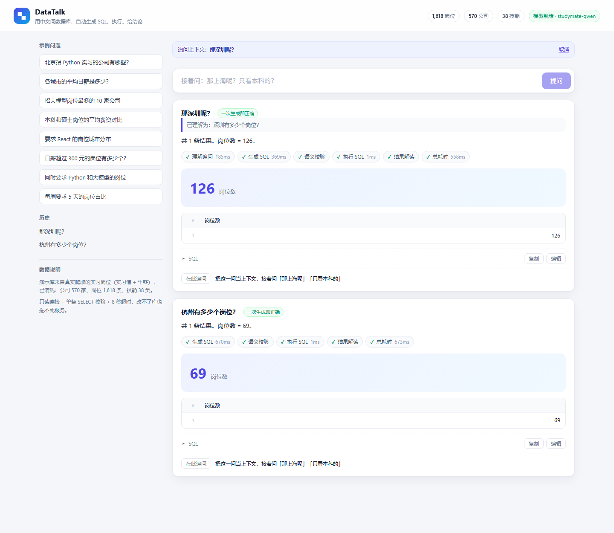

# DataTalk · 用中文查数据库

> 输入一句人话 → 自动生成 SQL → 只读执行 → 失败自动修 → 给出表格和图表。



大多数「NL2SQL Demo」只做到「把模型生成的 SQL 打印出来」，一遇到字段名写错、聚合写错、加了不该加的过滤条件就崩。这个项目把重点放在**它出错的那 90%**：在 SQL 真正打到数据库之前，先过三道校验；执行失败时带着数据库的原始报错去修正；改不好就老实说改不好，而不是给一个看起来对的结果。

## 它长什么样

- 左边示例问题与历史，右边问答流
- 每个回答带**执行时间线**：生成 SQL → 语义校验 → 执行 → 结果解读，每步耗时与结果都可查
- 结果可切换「图表 / 表格」，SQL 可以展开、手改、重新执行
- 结果卡上标明这次是「一次生成即正确」还是「经自动修正」

## 三道护栏

| 层级 | 检查什么 | 拦掉的典型错误 |
| --- | --- | --- |
| 静态校验 | 单条语句、只允许 SELECT/WITH、关键字黑名单 | 模型顺手写出 `DROP`、多语句注入 |
| 语义校验 | 表/列是否存在、枚举值是否合法、是否加了问题里没提的过滤条件、按技能筛选是否用了 `job_skills` | `education='实习生'`、`city='帝都'`、问「北京 Python 岗」却加 `education='不限'` 把一半岗位过滤掉 |
| 执行校验 | 只读连接、8 秒超时、最多 200 行 | 笛卡尔积把服务拖死 |

任何一层不过，都会带着**具体原因**回到模型做自修复（默认最多 2 次）。修不好就返回失败原因，不编结果。

## 多轮追问：先说清「那上海呢」指的是什么



点结果卡上的「在此追问」，下一句就可以只说半句。后端会先把追问改写成独立问题，再走原来的生成流程——所以它不会把「那深圳呢？」理解成「深圳的什么东西」，而是明确改写成「深圳有多少个岗位？」（前端会把改写结果显示出来，猜错了你能立刻看见）。

```
问：杭州有多少个岗位？        → 69
追问：那深圳呢？              → 改写为「深圳有多少个岗位？」→ 126
再追问：只看要求 Python 的？   → 改写为「只看要求 Python 的深圳岗位数」→ 114
```

为什么不让模型直接带着上下文生成 SQL？因为**改写是可检查的一步**：改写结果是一句人话，你能一眼看出它有没有理解错；直接生成 SQL 的话，理解错了只能靠读 SQL 猜。多一次调用（约 0.5s）换一个可审计的中间态，值。

## 评测：不是"看起来对"，是"结果集对"

102 道题，覆盖计数、薪资统计、分组排序、技能连表、多条件组合五类；每题有金标准 SQL，判定方式是**执行结果集逐值比对**（不是比对 SQL 字符串，同一语义有无数种写法）。完整报告见 [`docs/eval-report.md`](docs/eval-report.md)。

| 指标 | 数值 | 说明 |
| --- | --- | --- |
| 执行准确率 | **82.4%** | 84 / 102 题结果集完全一致 |
| 首次生成准确率 | 66.7% | 一次生成即正确 |
| 自修复救回 | 16 题 | 首次错、修复后正确 |
| 平均延迟 / P95 | 838ms / 2.0s | 端到端（本机 3B 模型） |

分类看：计数类 **100%**、薪资类 86%、技能类 75%、组合类 71%、分组排序 70%。

**护栏到底值多少？** 同一份题集、同一个模型，关掉语义校验再跑一遍：

| 配置 | 执行准确率 | 自修复救回 |
| --- | --- | --- |
| 语义校验 + 自修复（默认） | **82.4%** | 16 题 |
| 只留静态校验 | 74.5% | 3 题 |

差 7.8 个点，而且差距几乎全部来自「修复能不能修对」——语义校验给出的错误信息是精确的（"education 只能取 [...]"），SQLite 的原始报错是"no such column"，后者对 3B 模型几乎没有指导性。这条结论比准确率本身更有价值：**瓶颈不在生成，在反馈质量**。

还有一个反直觉的细节：关掉校验时**首次生成准确率反而更高**（71.6% vs 66.7%）。因为语义校验会误伤一部分本来就对的 SQL，逼它去"修复"，而修复有可能改坏。也就是说，护栏的代价是约 5 个点的误伤，换来的是约 13 个点的净收益——**它不是免费的，但在 3B 上非常划算**。

## 快速开始

已经构建好的话，两条命令就能跑：

```powershell
.\start.ps1            # Windows（首次会自动 npm ci + build）
./start.sh             # macOS / Linux
# 打开 http://127.0.0.1:8100/
```

Docker（镜像里前后端都装好了，模型仍走宿主机 Ollama）：

```bash
docker build -t datatalk .
docker run --rm -p 8100:8100 \
  -e LLM_BASE_URL=http://host.docker.internal:11434/v1 datatalk
# 或者：docker compose up --build
```

从零手动搭：

```powershell
# 1) 后端（Python 3.11+）
cd D:\datatalk
python -m venv .venv
.\.venv\Scripts\python.exe -m pip install -r backend\requirements.txt

# 2) 构建演示库（数据来源见下；仓库里已带 data/jobs.db，可跳过）
.\.venv\Scripts\python.exe backend\scripts\seed_db.py

# 3) 起服务
.\start.ps1
# 打开 http://127.0.0.1:8100/ ；API 文档 http://127.0.0.1:8100/docs
```

前端开发模式（改样式/交互时用）：

```powershell
cd frontend
npm install
npm run dev          # http://localhost:5174 ，/api 已代理到 8100
npm run build        # 产物给后端直接托管
```

## 配置

全部走环境变量（见 `.env.example`），默认接本机 Ollama：

| 变量 | 默认值 | 说明 |
| --- | --- | --- |
| `LLM_BASE_URL` | `http://127.0.0.1:11434/v1` | 任意 OpenAI 兼容端点：Ollama / DeepSeek / 百炼 |
| `LLM_MODEL` | `studymate-qwen` | 本机模型名 |
| `LLM_API_KEY` | 空 | 云端服务才需要 |
| `MAX_ROWS` | `200` | 单次返回上限 |
| `QUERY_TIMEOUT` | `8` | 单条查询超时（秒） |
| `MAX_REPAIR` | `2` | 自修复最大轮次 |
| `SEMANTIC_CHECK` | `1` | 语义校验开关（`0` = ablation 模式） |
| `MULTI_TURN` | `1` | 多轮追问改写开关 |
| `HISTORY_TURNS` | `3` | 最多带几轮上下文 |
| `ALLOWED_TABLES` | 空（全部） | 表白名单，逗号分隔，如 `jobs_v,companies_v` |
| `DATATALK_DB` | `data/jobs.db` | 数据库路径 |

### 接自己的库

1. **换连接**：`backend/app/db.py` 的 `connect()` 是唯一碰数据库的地方，换成 `psycopg` / `pymysql` 即可，上层不用动。
2. **只读账号**：给它 `SELECT` 权限，最好再落一层只读视图（`jobs_v` 之类的），账号本身没有写权限。
3. **表白名单**：`ALLOWED_TABLES=jobs_v,companies_v`。白名单同时作用于**模型看到的 schema**（看不到的表它不会写）、**静态校验**（写了也拒）和**语义校验**（给出明确拒绝原因）。
4. 已经有 `mode=ro` + `PRAGMA query_only` + 单条 SELECT + 超时，四层里任意一层都能兜住。

## 演示数据

库来自真实爬取的实习招聘 JD（实习僧 1,604 条 + 牛客 436 条，去重并清洗后 **1,618 条岗位 / 570 家公司 / 38 类技能**），清洗掉了「城市写成"可转正"」「日薪 2.5 元」这类脏数据（`backend/scripts/seed_db.py` 里可见规则）。

表结构：

```
companies(id, name, city, industry, job_count)
jobs(id, company_id, title, city, salary_min, salary_max, salary_avg,
     education, days_per_week, months, source, publish_date, url, jd_text)
skills(id, name, category)
job_skills(job_id, skill_id)
```

## 测试

```powershell
cd backend
..\.venv\Scripts\python.exe -m pytest tests -q
# 21 passed —— 校验/白名单/多轮改写/语义 lint/图表推断，全部不依赖模型
```

模型调用的地方都做了注入：测试里替换掉 `pipeline.llm.chat` 就能跑，不需要起 Ollama。

## 目录

```
backend/
  app/
    main.py       FastAPI 路由（/api/ask /api/sql /api/schema /api/health）
    pipeline.py   NL2SQL 主流程 + 追问改写 + 语义校验 + 图表推断 + 结论生成
    db.py         只读执行、SQL 静态校验、表白名单、schema 自省
    semantic.py   指标口径、同义词、few-shot 示例检索
    llm.py        OpenAI 兼容调用
  scripts/
    seed_db.py        从原始 JD JSON 构建演示库
    make_eval.py      生成 102 题金标准
    eval_nl2sql.py    跑评测并出报告
  tests/          21 个单测
frontend/         React + TS + Vite + ECharts（图表按需加载）
docs/             设计说明与评测报告
scripts/          CDP 截图等开发脚本
Dockerfile / docker-compose.yml / start.ps1 / start.sh
```

## 已知限制

- 本机 3B 模型（Qwen2.5-3B）在复杂多表聚合上仍会出错，靠自修复兜底；换 7B/云端模型质量会明显提升（见 `docs/设计说明.md`）
- 追问改写是一次额外模型调用：提示词太短时可能把「那上海呢」改写得过于宽泛，前端会把改写结果显示出来供你核对
- 表白名单目前是 SQLite 表级；跨库要换 `db.py` 的连接层（步骤见上）
- 结果解读是规则模板，不是二次调用模型（牺牲一点自然度，换确定性和速度）
- Dockerfile 按官方镜像语法编写，本机没有 Docker 环境，**未实测构建**；Windows 下建议直接用 `start.ps1`

## 路线

- [x] 只读执行 + 三道校验 + 自修复
- [x] 图表/表格/时间线前端
- [x] 102 题金标准评测集 + 自动判分（比结果集，不比 SQL 字符串）
- [x] 语义校验 ablation（+7.8 个点，见上）
- [x] 只读账号与表白名单的可配置化
- [x] 多轮追问
- [ ] 查询结果缓存与成本统计